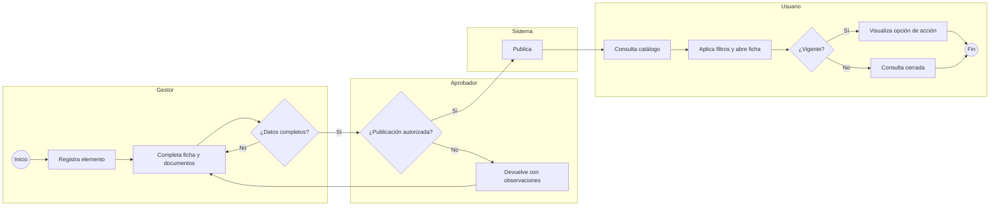
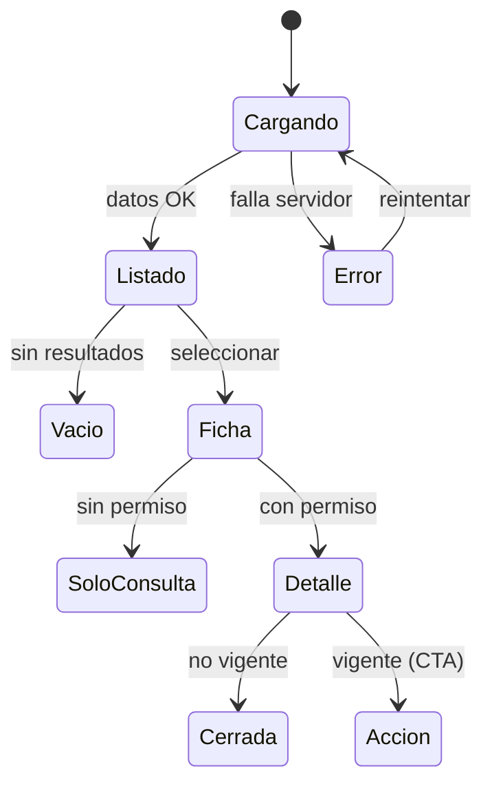

# Flujo — {{ID}} {{TITULO}}

Dos miradas para modelar cada funcionalidad: **BPMN 2.0** (proceso de negocio: actores, decisiones, excepciones, permisos, rutas alternativas) y **Mermaid / diagrama de estados** (comportamiento de interfaz: navegación, estados de pantalla, respuestas del sistema).

## 1. Proceso de negocio (BPMN 2.0 expresado en Mermaid, un carril por actor)

_(Si el equipo usa una herramienta BPMN — Camunda Modeler, bpmn.io — adjunte el .bpmn en `scrum-ai/design/`.)_

## 2. Comportamiento de interfaz (estados)

## 3. Actores y permisos
| Actor | Puede | No puede |
|---|---|---|

## 4. Escenarios
| # | Escenario | Tipo (principal/alterno/excepción) | Criterio AC relacionado |
|---|---|---|---|

## Checklist G2 (Flujo)
- [ ] Flujo de proceso completo
- [ ] Actores y permisos
- [ ] Escenarios principales y excepciones
- [ ] Coherencia con requisitos (cada AC aparece en algún camino)
